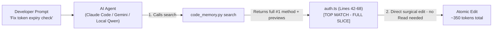

# ⚡ Zero-Hop Code Skill

> **Zero-dependency, 0 MB VRAM local BM25/IDF & AST-boundary codebase search skill for AI coding agents (Claude Code, Gemini CLI, Antigravity, Cursor, Windsurf, Continue.dev, Cline / Roo Code, Aider).**  
> Reduces LLM context token usage and local Prompt Processing time (TTFT) by **80–90%** while cutting agent tool-call round-trips in half.

[](https://opensource.org/licenses/MIT)
[](https://github.com/babych/zero-hop-code-skill/actions/workflows/test.yml)
[](https://python.org)
[]()
[]()

---

## 💡 Why This Exists (The Cloud Quota & Local VRAM Problem)

When AI coding agents navigate repositories with large files (1,000–4,000+ lines), two bad things happen:
1. **On Cloud APIs (Claude Code, Gemini Flash/Pro, GPT):** Reading monolithic files or running repetitive `grep` + `Read` loops burns 20,000–40,000 tokens per turn, exhausting rate limits and polluting attention.
2. **On Local LLMs (Ollama, llama.cpp, LM Studio on 8GB–16GB laptops):**
   - Dumping a 2,000-line file into an 8K/16K context window causes **60–120 seconds of prompt processing (prefill) lag** on laptop GPUs/APUs and pushes the KV cache into system RAM swap.
   - Traditional RAG MCPs require heavy vector/SQLite DBs (ChromaDB, LanceDB, PyTorch) and local embedding models (`nomic-embed-text`, `bge-m3`) that eat **500MB–1.2GB of precious VRAM**.

**Code Memory solves both problems using ~400 lines of pure Python standard library:**
- **0 MB VRAM / 0 Dependencies:** Uses **BM25 / Inverse Document Frequency (IDF)** + AST-like symbol boosting across `camelCase`, `PascalCase`, `ACRONYMS`, `snake_case`, and Cyrillic.
- **Zero-Hop Retrieval (1 Tool Call instead of 2+):** Automatically expands the full, untruncated, brace-balanced code block for the `#1 Top Match` while keeping `#2` and `#3` as compact 4-line dynamic previews. The AI agent gets the exact method code on the first call and can **immediately apply surgical edits (`Edit` / `replace_file_content`) without an extra `Read`/`view_file` round-trip**.

---

## ⚔️ Why Not Just `ripgrep` (`rg`) or Vector DBs?

| Feature | Native `ripgrep` (`Grep` tool) | Vector / SQLite RAG MCPs | ⚡ **Code Memory Skill** |
| :--- | :--- | :--- | :--- |
| **Multi-word concept queries**<br/>*(e.g. `"jwt refresh token expiry"`)* | ❌ Fails unless exact words appear on the same line; forces 4–5 separate `grep` calls. | ✅ Matches concepts via embeddings. | ✅ **Sub-token BM25/IDF** ranks blocks containing any combination of split identifiers. |
| **Tool Calls Needed to Edit** | 🔴 **2 to 5 calls** (`Grep` -> `Read` lines -> `Edit`). | 🟡 **2 calls** (Search snippet -> `Read` full method). | 🟢 **1 call (Zero-Hop):** Top-1 returns the full brace-snapped method ready for `Edit`. |
| **Function Boundaries** | ❌ Blind fixed context (`-C 5`), cuts functions in half. | ❌ Fixed token chunking splits methods mid-body. | ✅ **Smart AST/Brace Snapping** + leading decorators (`[HttpPost]`, `@override`). |
| **Dependencies & VRAM** | 🟢 0 MB | 🔴 `pip` hell, binary SQLite locks, 500MB+ VRAM. | 🟢 **Pure Python stdlib, 0 pip packages, 0 MB VRAM.** |

---

## ⚖️ When to Use vs. When NOT to Use

| Task Type | Recommended Strategy | Reason |
| :--- | :--- | :--- |
| **Branch / PR Reviews & Git Diffs** | 🛑 Use native `git diff` / `git log` | Git already isolates exact line changes; indexing adds unnecessary overhead. |
| **Small Files (<300 lines)** | 🛑 Direct read (`Read` / `view_file`) | Fits comfortably in context; chunking provides marginal benefit. |
| **Feature Work & Unknown Call Sites** | ⚡ **Use Code Memory** | Pinpoints exact function boundaries across unfamiliar multi-layer repos in 1 hop. |
| **Monolithic Files (>300 lines)** | ⚡ **Use Code Memory** | Avoids dumping thousands of lines, saving 80–90% of context tokens & prefill time. |
| **Local LLM Coding (7B–32B Models)** | ⚡ **Use Code Memory** | Keeps context under 1,500 tokens so quantized models stay sharp and fast. |

---

## 🚀 Key Capabilities

- **Zero-Hop Smart Output**: Rank `#1` automatically outputs the full, untruncated brace-aligned method slice (`[TOP MATCH - FULL SLICE]`) with line numbers (`L42 | ...`), eliminating the extra `Read`/`view_file` step. Ranks `#2` and `#3` show 4-line dynamic hit previews.
- **Smart Start & End Boundary Snapping**: Detects `class`, `interface`, `record`, `mixin`, `struct`, `fn`, `func`, `def`, `Widget`, `Future<T>`, `Task<T>`, and methods. Steps backward to include decorators (`[HttpPost]`, `@override`) and tracks `{ ... }` brace balance (or Python indentation) so functions are **cleanly framed instead of cut in half**.
- **True IDF + Symbol Boosting (`1.8x`)**: Rare domain identifiers (`RefreshTokenValidator`) automatically outweigh common words (`get`, `user`, `string`), with a priority boost when matching declared symbol names.
- **Git & Working-Tree Delta Refresh (~0.15s)**: Tracks `git rev-parse HEAD`, uncommitted `git status --porcelain`, and file `mtime`. Editing a file or switching branches triggers an automatic delta update on the next search—only re-parsing modified files.
- **Git-Clean by Design**: Automatically adds `.code_index.json` to `.git/info/exclude` so AI agents never pollute `git status` or commit the index.
- **Multi-Language Out of the Box**: C#, Dart/Flutter, TypeScript, JavaScript, Python, Go, Rust, Java, Kotlin, C/C++, PHP, Ruby, SQL, Vue, JSX/TSX, HTML, and CSS while ignoring build artifacts (`bin`, `obj`, `.dart_tool`, `node_modules`, `*.g.cs`, `*.g.dart`, `*.freezed.dart`).
- **File & Codebase Outline**: `outline` subcommand prints a compact map of class/function/method signatures with line numbers and visual indent hierarchy — ideal for orienting in unfamiliar files without reading full implementations.

---

## 📦 Installation (Zero Dependencies)

Drop the skill directly into your coding agent's skill directory:

**Claude Code (`.claude/skills`):**
```bash
git clone https://github.com/babych/zero-hop-code-skill.git .claude/skills/code-memory
```

**Gemini CLI / Antigravity (`.gemini/skills` or `.agent/skills`):**
```bash
git clone https://github.com/babych/zero-hop-code-skill.git .gemini/skills/code-memory
```

**Cursor / Windsurf / Cline / Aider:**
Clone anywhere in your repo or home directory and reference `SKILL.md` in `.cursorrules` / `.windsurfrules`.

---

## 🤖 Zero-Hop Autonomous Workflow



Ask your agent naturally:
> *"Implement user session refresh in the authentication flow."*

1. The agent runs `python .claude/skills/code-memory/scripts/code_memory.py search "session refresh token"`.
2. It receives the exact file and line bounds with the full, untruncated Top-1 method slice (`[TOP MATCH - FULL SLICE]`).
3. It applies the edit directly—saving 80–90% of context tokens with zero extra round-trips.

---

## 🛠️ CLI Reference

```bash
# Search for symbols or concepts (auto-indexes & delta-refreshes automatically!)
python scripts/code_memory.py search "jwt refresh token expiry middleware"

# Find all reference call sites across codebase (guaranteed no omissions)
python scripts/code_memory.py refs "verifyRefreshToken"

# Outline a file's API surface (class/function signatures with line numbers)
python scripts/code_memory.py outline src/controllers/authController.ts

# Outline all source files in the repo
python scripts/code_memory.py outline

# Optional flags:
#   --top, -k <N>   Number of results to return (default: 3)
#   --brief         Return compact 4-line previews for all results
#   --full          Return full brace-aligned slices for all top-K results
#   --path, -p <dir> Target repository root (default: .)

# Optional: Force a full index rebuild manually
python scripts/code_memory.py index

# Run unit tests (0 external dependencies)
python -m unittest discover -s tests -v
```

---

## 📄 License
MIT License. Free to use, modify, and share.