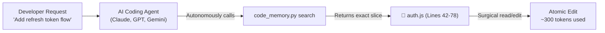

# ⚡ Code Memory Skill

> **Zero-dependency local vector & symbol search for AI coding agents (Antigravity, Cursor, Claude Code, Windsurf, Aider).**  
> Reduces LLM context token usage by **80–90%** during codebase refactoring.

[](https://opensource.org/licenses/MIT)
[](https://python.org)
[]()

---

## 🏛️ Historical Context & Architectural Lineage

Code discovery and retrieval have evolved through three distinct eras:

1. **The Classical Era (1990s–2000s: `ctags`, `gtags`, BM25 / LSI):**
   Vim and Emacs hackers mastered sub-millisecond symbol lookup using static tag files. It was lightning fast and zero-overhead, but predated LLMs—lacking semantic/fuzzy search and unaware of modern AI agent tool boundaries.
2. **The Intermediate Era (Aider’s Repo Map):**
   Paul Gauthier’s [Aider](https://aider.chat/) introduced AST parsing with PageRank to build condensed repository maps. However, it injects the entire map into every prompt turn and isn't packaged as an on-demand, queryable CLI tool for external agents.
3. **The Heavyweight Era (Cursor, Sourcegraph Cody, Vector DBs):**
   Modern tools turned to heavy local vector databases (ChromaDB, Pinecone, LanceDB) or cloud embedding APIs. While powerful, they introduce multi-gigabyte dependencies (PyTorch), high background memory usage, and friction in locked-down or air-gapped environments.

**Code Memory synthesizes the best of these approaches:**
- From **`ctags`**: Zero external dependencies and deterministic offline speed.
- From **IR / BM25**: Fuzzy, camelCase/snake_case sub-token retrieval without neural network overhead.
- From **Modern Agent Tooling**: Native output formatting (`Lines 42 - 78`) specifically designed for LLM range tools (`StartLine`/`EndLine`).

---

## ⚖️ When to Use vs. When NOT to Use

| Task Type | Recommended Strategy | Reason |
| :--- | :--- | :--- |
| **Branch / PR Reviews & Git Diffs** | 🛑 Use native `git diff` / `git log` | Git already isolates the exact line changes; indexing adds unnecessary overhead. |
| **Small Files (<300 lines)** | 🛑 Direct read (`view_file`) | Fits comfortably in context; chunking provides marginal benefit. |
| **Feature Work & Unknown Call Sites** | ⚡ **Use Code Memory** | Pinpoints exact function boundaries across unfamiliar multi-layer repos. |
| **Monolithic Files (>300 lines)** | ⚡ **Use Code Memory** | Avoids dumping thousands of lines, saving 80–90% of context tokens. |
| **Exploratory Bug Hunting** | ⚡ **Use Code Memory** | Rapidly surfaces business logic and formula definitions. |

---

## 🚀 Key Features

- **Zero External Dependencies**: Standard Python standard library only (`re`, `math`, `json`, `pathlib`). No PyTorch, ChromaDB, Hugging Face, or OpenAI API keys needed.
- **Blazing Fast**: Indexes 10,000 lines of code in < 0.2s; searches in < 0.02s.
- **Agent Native**: Formatted specifically for LLMs and agent tool calls (`SKILL.md` compliant).
- **Cross-Platform**: Handles Windows console encodings (UTF-8, cp1251, cp1252) and Linux/macOS out of the box.

---

## 🤖 Autonomous AI Workflow (Zero Manual Typing)

You don't need to run search commands manually. The AI agent executes this tool autonomously:



### 1. Give the Skill to Your Agent
Simply clone this repository or drop `SKILL.md` into your agent's skills directory:
- **Antigravity / Gemini:** Clone to your skills directory or reference via prompt.
- **Claude Code:** Add to `CLAUDE.md` or tools directory.
- **Cursor / Windsurf:** Add to `.cursorrules` or `.windsurfrules`.

### 2. Prompt Naturally
Ask your agent to implement a feature, find a bug, or explore the architecture:
> *"Implement user session refresh in the authentication flow."*

The AI agent will:
1. Detect that the repository has large/monolithic files.
2. Autonomously execute `python scripts/code_memory.py search "session refresh"`.
3. Receive the exact file and line bounds (`Lines 42 - 78`).
4. Read and modify *only* that slice—saving 80–90% of context tokens with zero token bloat.

---

## 🛠️ CLI Reference (For Debugging / Manual Verification)

If you ever want to test or inspect the index manually:

```bash
# Rebuild the local chunk index (.code_index.json)
python scripts/code_memory.py index

# Search for symbols or concepts
python scripts/code_memory.py search "jwt refresh token expiry middleware"
```

**Output:**
```text
🔍 Top relevant code locations for: 'jwt refresh token expiry middleware'
============================================================
📍 src/middleware/auth.js (Lines 42 - 78) [Score: 0.315]
   | export async function verifyRefreshToken(token) {
   |     const decoded = await jwt.verify(token, SECRET);
   |     if (Date.now() >= decoded.exp * 1000) throw new Error("Expired");
------------------------------------------------------------
📍 src/controllers/authController.js (Lines 112 - 145) [Score: 0.284]
   | const newToken = await refreshUserSession(refreshToken);
------------------------------------------------------------
```

---

## 📄 License
MIT License. Free to use, modify, and share.
